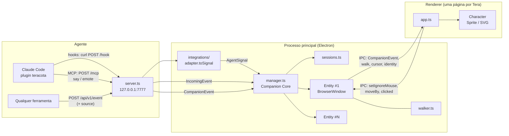

# Relatório de status do projeto: Teracota

> **Correção de status (2026-10-30):** a `v0.1.0` **já foi publicada** como *pre-release* no
> GitHub em 2026-10-01 (tag `v0.1.0` em `05dc270`). Este relatório é histórico; o estado atual
> está em `reports/consolidacao/RELATORIO.md`.

> Gerado em 2026-10-01, a partir do estado real do repositório (commit `c0f3cb9`).
> Os resultados de testes, typecheck, lint e build são de uma execução feita durante a
> geração deste relatório (seção 4.2). Medições de CPU e memória são de execuções
> anteriores e estão marcadas como tal.

---

## 1. Identificação

| Item | Valor |
|---|---|
| **Nome** | **Teracota** (app). A personagem se chama **Tera**. |
| **Nome anterior** | `waifu-claude` → `Terracota` (2 Rs) → `Teracota` (renomeado em 2026-10-01) |
| **Objetivo** | Personagem de desktop (um "desktop pet") que reage em tempo real ao que um agente de programação está fazendo: lendo, editando, rodando comando, erro, pedido de permissão, fim de tarefa |
| **Problema que resolve** | Mostra o estado do agente de forma ambiente, sem precisar olhar o terminal. É útil principalmente com **várias sessões em paralelo** (saber qual está esperando você). Também tem valor de companhia e diversão. |
| **Público-alvo** | Desenvolvedores que usam Claude Code (hoje). No futuro, usuários de outros agentes (Codex, OpenCode). |
| **Repositório** | https://github.com/kyotodevIndie/teracota (público). Pasta local: `K:\dev\waifu-claude`. |
| **Branch** | `main` (única), 15 commits, árvore limpa, sincronizada com `origin/main` |
| **Versão** | `0.1.0` (`package.json` e `plugin/.claude-plugin/plugin.json`). **Nenhuma tag nem release publicada.** |
| **Licença** | Código: MIT ([LICENSE](LICENSE)). Arte da Tera (`assets/`): CC BY 4.0 ([LICENSE-ART.md](LICENSE-ART.md)) |
| **Autor dos commits** | Thallys Morais `<kyotodevindie@gmail.com>` (git config **local** do repositório) |

### Stack

| Camada | Tecnologia |
|---|---|
| App desktop | **Electron 44** (main + preload + renderer), sem framework de UI: DOM, Canvas 2D e SVG |
| Linguagem | **TypeScript 7** estrito (`noUncheckedIndexedAccess`, `verbatimModuleSyntax`) |
| Build | **esbuild** via [build.mjs](build.mjs); tipos checados à parte (`tsc --noEmit`) |
| Integração com agentes | Hooks do Claude Code via `curl` → HTTP local; **MCP** (`@modelcontextprotocol/sdk` 1.30, Streamable HTTP sem estado) servido pelo próprio app; `zod` 3 |
| Testes | **Vitest 5** |
| Lint | **Biome 2** (só linter; formatador desligado de propósito) |
| Empacotamento | **electron-builder 26** → instalador NSIS pro Windows |
| CI | GitHub Actions ([.github/workflows/ci.yml](.github/workflows/ci.yml), [release.yml](.github/workflows/release.yml)) |
| Distribuição da integração | Plugin do Claude Code, com o próprio repositório servindo de marketplace |

---

## 2. Estado atual

### 2.1 Implementado e funcionando

**Reação ao Claude Code (ponta a ponta, validado no Windows):**
- O plugin (`plugin/hooks/hooks.json`) envia por `curl` os eventos `SessionStart`, `UserPromptSubmit`, `PreToolUse`, `PostToolUseFailure`, `Notification`, `Stop` e `SessionEnd` pra `POST 127.0.0.1:7777/hook`.
- O adapter ([src/main/integrations/claude-code/adapter.ts](src/main/integrations/claude-code/adapter.ts)) traduz cada evento em estado: `reading`, `searching`, `typing`, `terminal`, `web`, `delegating`, `error`, `attention`, `happy`, `sleeping`, `listening`, `thinking`.
- O usuário confirmou (2026-10-01) o funcionamento com o app instalado + o plugin `teracota@teracota`.

**MCP próprio:** as ferramentas `say` e `emote` ([src/main/mcp.ts](src/main/mcp.ts)) são servidas em `/mcp`. A chamada é roteada pra Tera da sessão que a fez (pareando com o `PreToolUse` da ferramenta MCP, numa janela de 5s).

**Modos (menu):**
- *Uma Tera só* (agrega as sessões, com etiqueta de origem no balão) ou *uma por sessão de agente* (até 5 janelas, com cor e plaquinha).
- *Passear pela tela* ou *ficar parada*.

**Personagem:**
- Skin de sprites "Tera" (13 animações × 4 frames, PNG 512px) com movimento procedural ([wobble.ts](src/renderer/wobble.ts)).
- Balanço físico ao arrastar ([pendulum.ts](src/renderer/pendulum.ts)).
- Escala por animação, máscaras de clique por alfa e taxa de quadros adaptativa.
- Skin "clássica" em SVG como reserva.

**Interações:** clique, arrastar, carinho, balão de fala com animação de "falando", olhos seguindo o cursor (só na SVG).

**App:**
- Bandeja do sistema e menu de contexto compartilhado ([menu.ts](src/main/menu.ts)).
- Instância única e preferências persistidas, com migração dos nomes antigos ([config.ts](src/main/config.ts)).
- Primeira execução: apresentação e "Abrir com o Windows" ligado (só no app instalado).
- O app de desenvolvimento roda como "Teracota Dev", com configuração própria.

**Arquitetura de adapters (Companion Core):**
- O core não conhece agentes: há um teste que garante isso ([integrations.test.ts](src/main/integrations/integrations.test.ts)).
- Capabilities por adapter; sessões identificadas por `provider:sessionId`; etiqueta "Agente · projeto" quando há agentes diferentes abertos.

**API local v1:** `POST /api/v1/event`, com `/event` como alias. Aceita `source` (provider/sessão/projeto) e `lifecycle`. Validada de ponta a ponta com o app de desenvolvimento em 2026-09-30 ([docs/API.md](docs/API.md)).

**Conexão com o agente:**
- "Conectar ao Claude Code" instala o plugin pela CLI (`claude plugin marketplace add` + `install`), com um comando de uma linha como reserva.
- Oferta automática, uma vez por instalação ("Achei o Claude Code! Clica em mim"). Só instala com o clique.
- "Conectar sessões já abertas" copia `/reload-plugins`.

**Distribuição:** o instalador NSIS é gerado com `npm run dist` (`release/Teracota Setup 0.1.0.exe`, ~120 MB, sem assinatura). O usuário instalou e usou esse instalador.

### 2.2 Implementado, mas com validação parcial

| Item | Situação |
|---|---|
| `/reload-plugins` nas sessões já abertas | Implementado (só copia o comando). **Não foi confirmado** se o comando carrega os **hooks** do plugin numa sessão aberta, além de comandos e skills. |
| Oferta automática de conexão | A detecção foi validada (o flag `connectOffered` foi gravado no app de dev). O **clique que instala** foi validado só pelo menu, não pela oferta. |
| Modo "uma por sessão" com o plugin real | Testado com sessões simuladas via HTTP. Com várias sessões reais do Claude, validado só numa versão anterior. |
| Passeio entre monitores com escalas diferentes | Não testado de forma sistemática (pode haver variação de tamanho de janela). |
| Instalador da última versão | O `.exe` em `release/` (12:18) é **anterior** ao commit `c0f3cb9` (12:29). O app instalado na máquina do usuário **não tem** o item "Conectar sessões já abertas". |

### 2.3 Só documentado ou planejado (não iniciado)

| Item | Onde está documentado |
|---|---|
| **Focus Mode** (Pomodoro/Focus Session, modos `agent`/`focus`/`hybrid`, resolução de prioridades de estado, histórico local) | Citado como "a definir" no [ROADMAP.md](ROADMAP.md). O usuário descreveu o escopo numa conversa, **mas a implementação não foi autorizada**, e o "Development Brief" de referência **não está no repositório**. |
| Adapters do **Codex** e do **OpenCode** | [docs/INTEGRACOES.md](docs/INTEGRACOES.md) (mapeamento inicial do OpenCode). Adiados de propósito até investigar as interfaces oficiais. |
| Adapter SDK, adapters externos da comunidade | docs/INTEGRACOES.md, depois de 3 integrações reais |
| Sprites com 8 frames, peças recortadas (rabo, orelhas, piscar, boca) | ROADMAP v0.3 |
| Várias Teras interagindo (desviar, cumprimentar, aplaudir) | ROADMAP v0.4 |
| Atualização automática, tela de configurações, i18n (inglês), sons, atalhos | ROADMAP v0.4 |
| macOS, Linux, instalador assinado, skins da comunidade por `.zip` | ROADMAP v1.0 |
| Landing page / site de documentação | Não existe nem está planejado nos documentos (veja a seção 7) |

---

## 3. Arquitetura

### 3.1 Estrutura de diretórios

```
src/
  shared/      contratos compartilhados (sem Electron)
    protocol.ts   CompanionEvent, EventSource, IncomingEvent, parseEvent/parseIncoming/parseSource
    ipc.ts        canais IPC e a CompanionApi (window.teracota)
    skin.ts       formato de skin (poses, scale, swing, hit masks)
    brand.ts      APP_NAME, CHARACTER_NAME, MCP_SERVER_NAME, GITHUB_REPO, cores
  main/        processo principal (Electron/Node)
    main.ts       ciclo de vida, instância única, bandeja, IPC, nome "Dev"
    server.ts     HTTP 127.0.0.1: rotas dos adapters, /api/v1/event, /event, /mcp, /health
    integrations/ adapters de agentes (fronteira arquitetural)
      types.ts      AgentAdapter, AgentSignal, AgentCapabilities, AgentConnector
      index.ts      registro ADAPTERS, providerInfo, capabilities da comunidade
      claude-code/  adapter.ts (hooks → sinais), connect.ts (CLI/plugin)
    manager.ts    Companion Core: sessões → qual Tera mostra o quê; modos; etiquetas
    sessions.ts   SessionTracker (chave provider:sessionId, expirações)
    entity.ts     uma Tera = BrowserWindow transparente + Walker + ponte IPC
    walker.ts     passeio (move a janela com setBounds)
    connect-flow.ts  conectar/oferecer/reconectar (genérico pra adapters)
    mcp.ts        servidor MCP (say/emote)
    menu.ts       menu de contexto/bandeja
    skins.ts      descoberta de skins + máscaras de clique (nativeImage)
    config.ts     preferências + migração de nomes antigos
    paths.ts      assets dentro ou fora do .asar
  preload/     preload.ts (contextBridge → window.teracota)
  renderer/    página de cada Tera
    app.ts        estados, reações, mouse (hover por polling), arrasto, fala
    character.ts  interface Character (plugável)
    sprite-character.ts / svg-character.ts  implementações
    wobble.ts, pendulum.ts, look.ts, states.ts, bubble.ts, pet.ts
assets/        skins/tera (52 PNGs + skin.json), icons/ (app e bandeja)
plugin/        plugin do Claude Code (hooks.json, .mcp.json, plugin.json)
.claude-plugin/marketplace.json   o repositório como marketplace
scripts/       demo.ts (percorre os estados), import-skin.ts (pacote GPT → skin)
docs/          ARQUITETURA.md, INTEGRACOES.md, API.md
```

São cerca de 3.300 linhas de TypeScript (contando os testes).

### 3.2 Fluxo de dados



**Camadas e regra de dependência:** adapters → core → renderer. Só o adapter conhece o formato nativo do agente. O core lida com `AgentSignal`/`CompanionEvent`, e o renderer só com `CompanionEvent`.

### 3.3 Decisões arquiteturais importantes

| Decisão | Justificativa | Arquivo |
|---|---|---|
| Hooks por `curl`, sem script Node | O usuário final não precisa ter Node. `curl` vem no Windows 10+, macOS e Linux. | plugin/hooks/hooks.json |
| MCP servido pelo próprio app (HTTP) | Não exige processo nem runtime externo, e o roteamento pra sessão certa acontece no core | src/main/mcp.ts |
| Rotas de adapter sempre respondem 204; hooks com `|| exit 0` e timeout curto | Nunca atrapalhar o agente, nem com o app fechado ou com payload inválido | server.ts, hooks.json |
| Servidor só em 127.0.0.1, recusa `Origin` e `Host` estranho | Bloqueia páginas web e DNS rebinding | server.ts, SECURITY.md |
| Fronteira de adapters + teste-guarda | Multi-agente sem `isClaude` espalhado pelo código | integrations/, integrations.test.ts |
| Hover por polling do cursor no main (33 ms) + máscara de alfa | O `setIgnoreMouseEvents({forward:true})` é instável no Windows, sobretudo com escalas mistas. Corrigiu o bug "não consigo clicar nela" | entity.ts, app.ts, skins.ts |
| Estado de "ignorar mouse" reafirmado a cada 1s | Autocorreção de divergências entre main e renderer | app.ts |
| Uma `BrowserWindow` por Tera; passeio move a janela | Simplicidade e reuso. A alternativa (uma janela por monitor) foi adiada | entity.ts, walker.ts |
| `setBounds` em vez de `setPosition` | Evita que a janela "cresça" com escala de DPI fracionada | walker.ts, entity.ts |
| Assets fora do `.asar` (`extraResources`) | São lidos via `file://` e `nativeImage` | package.json (build), paths.ts |
| Frames pré-redimensionados (`createImageBitmap`) + fps adaptativo (60/24/15) | CPU parada caiu de ~16% pra ~5% de um núcleo | sprite-character.ts |
| Ao trocar de modo, cria a janela nova antes de fechar as antigas | Senão o `window-all-closed` encerrava o app | manager.ts |
| App de dev = "Teracota Dev" | Convive com o instalado (configuração e trava separadas) | main.ts |
| Biome sem formatador | O formatador desfaria o alinhamento manual das tabelas de estados | biome.json |

### 3.4 Dependências e integrações externas

- **Runtime:** `@modelcontextprotocol/sdk` (que inclui express e afins), `zod`.
- **Claude Code:** CLI (`claude plugin ...`) usada pelo "Conectar". Os hooks seguem o formato documentado. O evento `PostToolUseFailure` foi confirmado na versão 2.1.224.
- **GitHub:** marketplace do plugin (`kyotodevIndie/teracota`), Actions, Releases (ainda vazio).

### 3.5 Pontos de extensão

| Extensão | Como |
|---|---|
| Novo agente | `src/main/integrations/<agente>/adapter.ts` + registrar em `ADAPTERS` ([docs/INTEGRACOES.md](docs/INTEGRACOES.md)) |
| Integração sem adapter | API local `/api/v1/event` com `source` |
| Nova skin | `assets/skins/<id>/skin.json` ou `%APPDATA%/Teracota/skins/<id>/`; `npm run import-skin` |
| Novo tipo de personagem (Live2D, rig) | Implementar `Character` ([character.ts](src/renderer/character.ts)) |
| Novo estado ou movimento | `protocol.ts` + `states.ts`; `wobble.ts` |
| Ferramenta MCP | `buildServer` em mcp.ts |

---

## 4. Qualidade e validação

### 4.1 Testes existentes

São 7 arquivos e **76 casos** (o teste-guarda gera um caso por arquivo do core). Todos são unitários, da lógica sem Electron:

| Arquivo | Casos | Cobre |
|---|---|---|
| [protocol.test.ts](src/shared/protocol.test.ts) | 11 | validação de eventos, `source`, `parseIncoming` |
| [skin.test.ts](src/shared/skin.test.ts) | 5 | leitura de `skin.json` (scale, loop, swing) |
| [sessions.test.ts](src/main/sessions.test.ts) | 9 | nome de projeto, chaves, expirações conforme capability |
| [adapter.test.ts](src/main/integrations/claude-code/adapter.test.ts) | 11 | hooks → sinais, MCP, ciclo de vida |
| [integrations.test.ts](src/main/integrations/integrations.test.ts) | 5 + 1 por arquivo do core | registro de adapters + **guarda da fronteira de agentes** |
| [pendulum.test.ts](src/renderer/pendulum.test.ts) | 5 | física do balanço |
| [look.test.ts](src/renderer/look.test.ts) | 3 | expressão/animação → pose |

**Não há** testes de `manager.ts` (roteamento real com entidades), `entity.ts`, `walker.ts`, `server.ts` (HTTP), `connect-flow.ts`, do renderer ou de ponta a ponta.

### 4.2 Execução durante a geração deste relatório (commit `c0f3cb9`)

| Verificação | Resultado |
|---|---|
| `tsc --noEmit` | **OK** |
| `biome lint` | **OK** (44 arquivos, sem diagnósticos) |
| `vitest run` | **76/76 passaram** (7 arquivos) |
| `node build.mjs` (esbuild) | **OK** |
| CI no GitHub (último run, `c0f3cb9`) | **success** (os dois runs anteriores também) |
| `claude plugin validate` (plugin e marketplace) | Passou na última vez que rodou, no commit `5a0ab56`. **Não foi reexecutado** neste relatório. |
| `npm run dist` (instalador) | Último build às 12:18 de 2026-10-01, **anterior ao HEAD**. Não foi reexecutado. |

### 4.3 Validações manuais anteriores (não repetidas agora)

- Windows 11, 2 monitores (um deles com coordenadas negativas):
  - app de dev;
  - app empacotado (`release/win-unpacked`);
  - instalador NSIS, instalado pelo usuário.
- Hooks reais do Claude Code (app desktop, aba Code, e CLI 2.1.224), modos single/multi, MCP via cliente HTTP.
- Hover/clique: teste automatizado com `WindowFromPoint`, 20/20 acertos (2026-09-23).
- **CPU e memória** (medidos em 2026-09-30):
  - parada: ~5,3% de um núcleo;
  - trabalhando: ~9,5%;
  - dormindo: ~6,7%;
  - memória: ~400–430 MB (4 processos Electron com 1 Tera).

### 4.4 Problemas conhecidos

1. **MCP com o app fechado:** o Claude Code mostra "MCP `teracota` falhou ao conectar (ECONNREFUSED)". Isso aconteceu nesta própria sessão. É inofensivo, mas confunde.
2. **`.mcp.json` na raiz do repositório** registra o MCP `teracota` pra sessões abertas na pasta do projeto. Com o plugin também instalado, **pode haver MCP duplicado** nessa pasta. Não foi verificado.
3. O instalador **não é assinado** (aviso do SmartScreen). O build não é reprodutível na CI até existir uma tag (o `release.yml` nunca rodou).
4. O ícone de atividade (emoji) tem posição fixa e flutua longe da cabeça nas poses sentadas.
5. Com só 4 frames por animação, o andar parece "picado".
6. Ficaram na máquina do desenvolvedor pastas `%APPDATA%/Terracota Dev` e `%APPDATA%/Terracota` de nomes antigos. São inofensivas.

### 4.5 Débitos técnicos

- Falta extrair a lógica de roteamento do `EntityManager` pra uma unidade pura e testável. Hoje ela está misturada com a criação de janelas.
- `npm run demo` ([scripts/demo.ts](scripts/demo.ts)) só cobre `CompanionEvent` simples. Não exercita `source`/`lifecycle`, modos nem o adapter.
- Sem formatador automático: o estilo depende de disciplina e do `.editorconfig`.
- A memória (~400 MB por app) vem do Electron. Cada Tera extra no modo multi soma um processo de renderer.
- Os textos são todos em pt-BR, sem i18n.

### 4.6 Plataformas

| Plataforma | Situação |
|---|---|
| Windows 11 x64 | **Testado** (dev, empacotado, instalado) |
| Linux | Só a CI (ubuntu-latest) roda typecheck, lint, testes e build. **O app nunca foi executado.** |
| macOS | **Nunca testado.** Já tem ajustes preparatórios (sem ícone no Dock, rótulo "Abrir ao iniciar o sistema"). |

---

## 5. Roadmap e progresso

A fonte é [ROADMAP.md](ROADMAP.md), com [CHANGELOG.md](CHANGELOG.md) e [docs/INTEGRACOES.md](docs/INTEGRACOES.md).

| Fase | Status real |
|---|---|
| **v0.1 Beta** | Implementada. **Não lançada** (sem tag nem release). |
| **v0.2 Companion Core** | Adapters, capabilities, identidade, API v1 e app Dev separado: **feitos**. **Focus Mode: não iniciado** (escopo descrito pelo usuário, implementação não autorizada, brief ausente). |
| v0.3 Animação | Não iniciada. Aguarda sprites com 8 frames do GPT. |
| v0.4 Várias Teras + experiência | Não iniciada |
| Marco de integrações (adapter #2/#3, SDK) | Não iniciado. Depende de o Companion Core estabilizar e de pesquisar as interfaces oficiais. |
| v1.0 | Não iniciada |

### Divergências entre o roadmap e a implementação

1. **Numeração de versão:** o CHANGELOG diz que a `[0.1.0]` é a "Primeira versão pública", mas nada foi publicado. A seção "Não lançado" contém o trabalho da v0.2 (Companion Core e renomeação), e o `package.json` continua em `0.1.0`. É preciso decidir se a primeira release pública vai ser `v0.1.0` (tudo junto) ou `v0.2.0`.
2. O ROADMAP marca a v0.1 com ✅ "Beta", mas ela não está disponível pra download. O link "Releases" do README leva a uma página vazia.
3. A **v0.2** inclui o Focus Mode no roadmap, mas ele não começou. Os itens ✅ da v0.2 estão de fato implementados.
4. O `npm run demo` não reflete a API v1 nem os adapters (é anterior a eles).

### Bloqueios e dependências

- **Focus Mode:** precisa do ok explícito e do "Development Brief" (seções 9–32 e 42–53 citadas pelo usuário).
- **v0.3:** sprites com 8 frames, a gerar com o GPT. Já existe um prompt sugerido pro GPT.
- **Release:** confirmação humana pra criar a tag. Ajustes no GitHub pendentes (seção 7).
- **macOS:** conta de desenvolvedor Apple pra assinatura e notarização (custo).

### Adiado de propósito

Adapters do Codex e do OpenCode, Adapter SDK, uma janela por monitor, assinatura de código, formatador automático.

---

## 6. Experiência do usuário

### Fluxo principal

1. Baixar e rodar o instalador. **Hoje não existe download público.** O usuário precisa clonar e rodar `npm run dist`.
2. A Tera aparece no canto da tela, se apresenta e o ícone surge na bandeja. "Abrir com o Windows" já vem ligado.
3. Depois de ~5s, se o Claude Code estiver instalado e sem o plugin, ela oferece: "Achei o Claude Code! Clica em mim que eu me conecto". Um clique instala o plugin.
4. Sessões novas do Claude Code já fazem a Tera reagir. Nas sessões já abertas, é preciso rodar `/reload-plugins`, que é copiado pelo menu.
5. Uso: a Tera senta no notebook quando o agente edita, fica confusa nos erros, acena pedindo permissão, comemora no fim, passeia e dorme quando ociosa. Clique, arrasto e carinho funcionam.

### "Telas" (não há janela de configurações)

- **A Tera:** janela transparente de 320×440, com balão de fala e plaquinha do projeto (no modo multi).
- **Menu de contexto / bandeja:**
  - mostrar e esconder;
  - passear ou ficar parada;
  - uma Tera ou uma por sessão;
  - skin;
  - voltar pro canto;
  - conectar ao Claude Code e conectar sessões abertas;
  - abrir com o Windows;
  - recarregar e DevTools (só em dev);
  - sair.

### Limitações que o usuário vai encontrar

Só Windows; aviso do SmartScreen; mensagem de erro do MCP com o app fechado; textos só em pt-BR; sem tela de configurações; até 5 Teras; animação com 4 frames; ~400 MB de memória.

### O que falta pra uma versão pública utilizável

1. **Release publicada,** com o instalador no GitHub Releases. É o bloqueio principal: hoje o README manda baixar algo que não existe.
2. Testar o instalador gerado pela CI numa máquina limpa.
3. Ajustes no repositório (descrição, label `skin`, relato privado de vulnerabilidades).
4. Desejável: README e mídia (gif) em inglês pra alcance; aviso amigável do MCP com o app fechado.

---

## 7. Publicação e documentação

| Item | Situação |
|---|---|
| README | Bom: instalação, uso, problemas comuns, privacidade, links. Badge de CI. Em pt-BR. **Sem gif nem screenshot.** O link de Releases leva a uma página vazia. |
| Instalação e uso | No README (incluindo os comandos manuais do plugin e `/reload-plugins`) |
| Arquitetura | [docs/ARQUITETURA.md](docs/ARQUITETURA.md), [docs/INTEGRACOES.md](docs/INTEGRACOES.md), [docs/API.md](docs/API.md) |
| Contribuição | [CONTRIBUTING.md](CONTRIBUTING.md), [CODE_OF_CONDUCT.md](CODE_OF_CONDUCT.md), [SECURITY.md](SECURITY.md), [CHANGELOG.md](CHANGELOG.md), [ROADMAP.md](ROADMAP.md), templates de issue (bug, sugestão, skin) e de PR |
| Build/distribuição | `npm run dist` local; `release.yml` (tag `vX.Y.Z` → checa a versão → `npm run check` → instalador → **rascunho** de release). **Nunca executado.** |
| CI | `ci.yml` em push/PR: typecheck, lint, testes, build, validação de JSON dos manifestos. Verde. |
| GitHub | Público. Tópicos ✅. **Descrição vazia**, label `skin` ausente, relato privado de vulnerabilidades não verificável pela API, 0 releases. |
| Site público | **Não existe** |

### Avaliação: landing page + docs com VitePress

**O que já serve:** os Markdown existentes (README, docs/*, CONTRIBUTING) migram quase sem mudança pra páginas do VitePress. O VitePress lê Markdown puro.

**O que falta:**
1. **Mídia:** gif ou vídeo da Tera reagindo a uma sessão real, mais screenshots dos modos. É o principal ativo de uma landing e hoje não existe.
2. **Release publicada,** pra que o botão "Download" aponte pro `latest`.
3. **Estrutura:**
   - `.vitepress/config` com `srcDir` ou uma pasta `site/`;
   - separar a doc de usuário (instalar, usar, problemas comuns, privacidade) da doc de dev (arquitetura, API, integrações, skins).
4. **Idiomas:** i18n do VitePress (pt-BR + en). Recomendado pra adoção fora do Brasil.
5. **Deploy:** workflow do GitHub Pages (Actions), com domínio próprio opcional.
6. **Cuidados:**
   - nome e marca sem sugerir afiliação com a Anthropic (o disclaimer já está no README);
   - a licença CC BY 4.0 da arte implica crédito nas imagens do site.
7. **Dependência nova:** `vitepress` como devDependency. Isso pede confirmação humana, pela regra de dependências mínimas.

---

## 8. Próximas ações recomendadas (não iniciadas)

1. **Publicar a primeira release:**
   - decidir a numeração (`v0.1.0` com tudo ou `v0.2.0`) e consolidar o CHANGELOG;
   - criar a tag;
   - testar o instalador gerado pela CI numa máquina limpa;
   - publicar o rascunho;
   - completar os ajustes do GitHub.
2. **Fechar as pontas da conexão:**
   - validar se `/reload-plugins` carrega os hooks numa sessão aberta;
   - verificar se `.mcp.json` + plugin duplicam o MCP na pasta do projeto (se duplicar, documentar ou remover o `.mcp.json` em favor do `settings.example.json`);
   - tornar amigável o erro do MCP com o app fechado.
3. **Focus Mode (resto da v0.2),** depois do ok e do brief:
   - engine de timer pura, baseada em timestamps e testável com Vitest;
   - resolução de prioridades de estado (interrupção > atividade > reação > base);
   - modo `hybrid`.
4. **Testabilidade do core:** extrair o roteamento do `EntityManager` pra uma unidade pura com testes; expandir o `npm run demo` pra API v1, `source`/`lifecycle` e modos.
5. **Adoção:** gif da Tera + README/CONTRIBUTING em inglês + landing VitePress no GitHub Pages; criar issues `good first issue` a partir do ROADMAP.

---

## 9. Informações para o próximo agente

### Contexto essencial

- O usuário (Thallys, GitHub `kyotodevIndie`) escreve em **pt-BR** e prefere **TypeScript**. Todo o código, os comentários, os documentos e os commits estão em pt-BR. Os nomes no código estão em inglês.
- **Git:** os commits do repositório usam `kyotodevindie@gmail.com`, configurado **localmente** (o git global tem o e-mail de trabalho, que **não pode** aparecer neste repositório). Os commits terminam com `Co-Authored-By: Claude ...`. O usuário autoriza push pra `main`.
- **Máquina do usuário (2026-10-01):**
  - Teracota instalado em `%LOCALAPPDATA%\Programs\teracota` (build anterior ao HEAD);
  - plugin `teracota@teracota` ativo, com marketplace `kyotodevIndie/teracota`;
  - o Terracota antigo e o plugin antigo foram removidos;
  - não há `settings.local.json` com hooks no repositório (o plugin cobre tudo; recriar duplicaria os eventos).
- Existe uma memória persistente do projeto em `C:\Users\vicen\.claude\projects\K--dev-waifu-claude\memory\`.

### Como validar rápido

- `npm run check` (typecheck + lint + testes, ~10s).
- **App de dev ao lado do instalado:** `TERACOTA_PORT=7788 npm start`.
- **Testar sem agente:**
  ```bash
  curl -X POST http://127.0.0.1:7777/api/v1/event -H "Content-Type: application/json" -d '{"state":"happy","say":"oi"}'
  ```
- **Screenshots no Windows:** PowerShell com `System.Drawing.CopyFromScreen`. As coordenadas de janela vêm da config (`x`/`y`) ou do canto da área de trabalho.
- **Validar o plugin:** `claude plugin validate ./plugin` e `claude plugin validate .`.

### Decisões que NÃO devem ser revertidas sem discussão

1. **Fronteira de adapters:** nada específico de agente fora de `src/main/integrations/`. O teste-guarda falha se isso for quebrado.
2. **Nunca atrapalhar o agente:** rotas de adapter sempre respondem 204, `toSignal` não lança erro, hooks com `|| exit 0`.
3. **Sem dependência de Node no usuário:** hooks via `curl`, MCP servido pelo app.
4. **Segurança local:** só `127.0.0.1`, recusa `Origin` e `Host` estranho.
5. **Hover por polling do cursor + máscara de alfa:** não voltar a depender dos eventos repassados pelo `setIgnoreMouseEvents`. Era a causa do bug de clique.
6. **`setBounds`** (não `setPosition`), **assets fora do `.asar`**, **criar a janela nova antes de destruir as antigas**.
7. **Não instalar o plugin sem o clique do usuário:** a oferta só instala com consentimento.
8. **Biome sem formatador:** preservar o alinhamento manual das tabelas.
9. **Migração de config** (`LEGACY_DIRS` em config.ts): manter os nomes antigos na lista.
10. **Identidade:** `teracota` (app, plugin `teracota@teracota`, MCP `teracota`, repo `kyotodevIndie/teracota`). Trocar de novo exige reinstalar o plugin pra todos.
11. **Licenças:** código MIT, arte CC BY 4.0. Skins contribuídas entram na CC BY 4.0.
12. **Não anunciar suporte a Codex ou OpenCode antes de validar o fluxo real** com interfaces oficiais.

### Pontos que precisam de confirmação humana

- Numeração e momento da primeira release, e a criação da tag.
- Começar o **Focus Mode** e receber o "Development Brief".
- Idioma da documentação pública (pt-BR, en ou ambos).
- Criar landing page/VitePress (dependência nova, domínio).
- Custos de assinatura (Windows e Apple) e a prioridade de macOS e Linux.
- Manter ou não o `.mcp.json` na raiz.
- Ajustes manuais no GitHub (descrição, label `skin`, relato privado de vulnerabilidades).
- Sprites com 8 frames e a arte de peças recortadas (vêm do GPT, pelo usuário).
